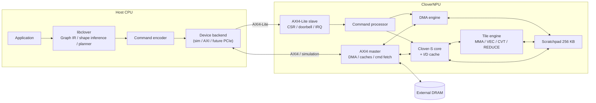
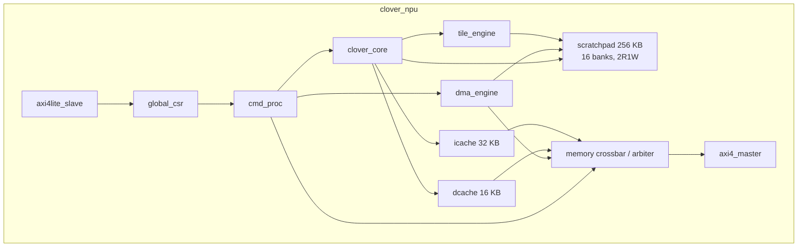
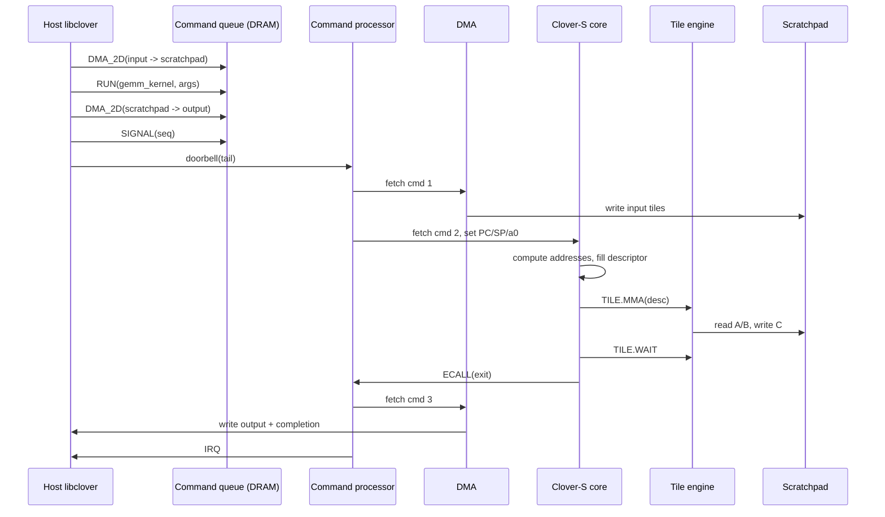
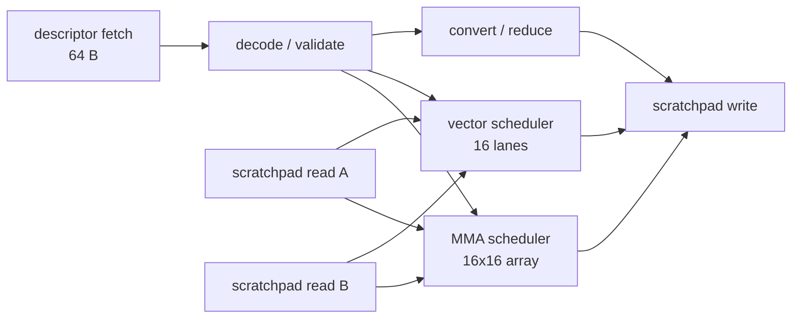

# 01 · 总体架构

## 1. 设计原则

CloverNPU 的核心判断是：**把“算子”留在软件，把“可复用的数据搬运与乘加原语”放进硬件。**

- 硬件只提供 MMA、流式向量运算、归约、格式转换、DMA、同步这些原语。
- GEMM、conv2d、softmax、layernorm、attention 等都由 Clover C kernel 组合原语实现。
- 所有 shape/stride 来自运行时描述符，RTL 中没有 `if (M == 224)` 这类特化。
- 主机负责图级调度；设备负责命令级执行。设备侧不实现图解释器。

这带来两个直接结果：

1. 编译器与 runtime 是主角，RTL 是可编程数据通路的载体。
2. 性能不会接近商用量产 NPU；本项目追求的是**可解释、可验证、可扩展**。

> **实现状态（M2b）**：标量核（ALU/regfile/decoder/5 级流水/CSR/trap）、汇编器、ISS、最小 C 编译器已完成，19 个 C 程序通过 ISS/RTL 差分。Scratchpad、cache、AXI、DMA、命令队列与 tile engine 尚未接入 RTL；当前 testbench 用直接映射的仿真内存。

## 2. 系统上下文



主机侧 `libclover` 不是“驱动一个固定算子库”，而是：

1. 接收 Graph IR；
2. 在 `execute` 时用真实输入 shape 做 shape inference；
3. 做 DRAM/scratchpad 内存规划；
4. 把每个 kernel launch 与 DMA 编码成 64 B 命令；
5. 写 doorbell，等待 completion ring / IRQ。

设备侧命令处理器只认识命令，不认识“conv”“attention”。

## 3. 顶层模块



### 3.1 时钟与复位

- 单时钟域 `clk`，名义 500 MHz；不承诺时序收敛。
- `rst_n` 异步置位、同步释放。
- 所有 AXI 接口使用同一时钟。

### 3.2 顶层参数

```systemverilog
parameter int NUM_PE_ROWS      = 16;
parameter int NUM_PE_COLS      = 16;
parameter int VEC_LANES        = 16;
parameter int SCRATCHPAD_KB    = 256;
parameter int ICACHE_KB        = 32;
parameter int DCACHE_KB        = 16;
parameter int AXI_DATA_WIDTH   = 128;
parameter int AXI_ADDR_WIDTH   = 32;
parameter int AXI_ID_WIDTH     = 4;
```

这些参数进入 `clover_pkg.sv`，RTL 不硬编码。

## 4. 执行模型

### 4.1 三层执行

| 层 | 执行者 | 单位 | 负责 |
|---|---|---|---|
| Graph | 主机 `libclover` | node | shape 推导、内存规划、命令编码 |
| Command | NPU command processor | 64 B command | DMA、kernel launch、wait、signal |
| Kernel | Clover-S core | C 函数 | 循环、地址计算、描述符填充、tile 指令 |
| Tile | tile engine | 64 B descriptor | 16x16 MMA、16-lane 向量、归约、转换 |

### 4.2 一次 graph 执行的时序



### 4.3 命令顺序语义

- 命令按 ring 顺序执行。
- `DMA_2D` 可以流水：连续 DMA 可同时 outstanding。
- `RUN` 在执行前等待所有更早的 DMA 完成（隐式 barrier），避免 kernel 读到未落地数据。
- `WAIT` 显式等待指定引擎。
- `SIGNAL` / `END` 等待所有引擎 idle，然后写 completion。
- 该语义牺牲一点重叠，换取可验证性；后续可加显式依赖位。

### 4.4 Kernel 启动约定

`RUN` 命令设置：

- `PC = entry`（DRAM 地址，通常 `0x1000_0000 + text_off`）
- `sp = stack_top`（scratchpad 高地址，16 B 对齐）
- `a0 = args_addr`（scratchpad 中的 `clover_kernel_args`）
- `ra = exit_trampoline`（设备内固定地址，执行 `ECALL(0)`）
- `gp = gp_base`（可选，v0.1 设为 0）

kernel 以 `ret` 返回 trampoline，trampoline 执行 `ECALL`，`a0 = 0` 表示正常退出。非零 `a0` 表示 kernel 错误码，CP 记录到 completion entry。

## 5. Clover-S 标量核

### 5.1 微架构

- 5 级顺序流水：IF / ID / EX / MEM / WB。
- 32 个 32-bit GPR，`x0` 恒为 0。
- 32-bit PC，字节寻址，小端。
- 分支预测：静态 not-taken；分支解析在 EX，误预测 2 周期惩罚。
- 乘法：单周期/多周期流水（v0.1 允许 4 周期）；除法：多周期或软件模拟（见 ISA）。
- 无 MMU、无 Cache 一致性硬件、无多 hart。
- 机器模式；异常入口 `mtvec`；`mret` 返回。
- 中断：单外部 IRQ（来自 command processor 的错误/完成），可屏蔽；v0.1 主要用轮询。

### 5.2 Cache

| 项 | I-cache | D-cache |
|---|---|---|
| 容量 | 32 KB | 16 KB |
| 关联 | 4-way | 4-way |
| Line | 64 B | 64 B |
| 替换 | LRU 近似 | LRU 近似 |
| 写策略 | — | write-through, no-write-allocate |
| 可缓存区域 | `0x1000_0000+` | `0x1000_0000+` |
| 不可缓存 | scratchpad、MMIO、tile/DMA/CP 寄存器 | 同左 |

D-cache 与 DMA 不硬件一致。软件责任：

- DMA 写 scratchpad/DRAM 后，若 CPU 要读该 DRAM 区域，先 `CACHE.INVAL_D`。
- CPU 写 DRAM 后，若 DMA 要读，先 `FENCE` + `CACHE.FLUSH_D`。
- 代码加载后，`CACHE.INVAL_I`。

张量默认放 scratchpad，控制结构放 scratchpad，避免大部分一致性问题。

### 5.3 与 tile engine 的接口

- 一条 `TILE.*` 指令把 64 B 描述符地址交给 tile engine。
- 指令在 tile engine 接收后退休（不是完成后）。
- tile engine 有 4 项 op queue；队列满时 core stall。
- `TILE.WAIT mask` 等待队列与执行完成；mask 见 ISA。
- tile engine 错误通过 `tile_status` CSR 与 `TILE.WAIT` 的异常/返回码暴露。

## 6. Tile engine

### 6.1 组成



- 描述符必须 64 B 对齐，位于 scratchpad。
- 引擎按 issue 顺序执行描述符（in-order），但 MMA 与 VEC 内部可流水。
- 16x16 MAC 阵列：每个 PE 一个 FP32 乘加单元与 FP32 累加器。
- 16 lane 向量单元：每 lane 一个 FP32 ALU，支持 FP32/INT32 运算。
- 归约单元：16 lane 求和/最大值树，输出标量或 16 lane 部分和。
- 转换单元：FP16/BF16/FP8/FP4 ↔ FP32，RNE，饱和策略见 §10。

### 6.2 MMA block 语义

一条 MMA 描述符处理 **一个 block**：

- `A`：`M x K`，`B`：`K x N`，`C`：`M x N`。
- `1 <= M,N,K <= 16`；边界由 mask 处理，不读/写越界元素。
- 默认布局：A row-major（行间 stride = `A_stride`），B row-major（行间 stride = `B_stride`），C row-major。
- `transpose_a`：A 按 `K x M` 存储；`transpose_b`：B 按 `N x K` 存储。
- `accumulate=1`：先把 C 读入 FP32 累加器；否则从 0 开始。
- 计算顺序：对每个 `(m,n)`，按 `k = 0..K-1` 顺序累加；每个 MAC 为“解包→scale→FP32 乘→FP32 加”。
- 低精度输入乘积在 FP32 中精确；因此不需要 FMA 也能得到与“精确乘积 + 单次加法舍入”一致的结果。
- 输出 `C` 按 `c_type` 转换；`c_type=FP32` 时直接写 FP32。

block 的循环由软件完成：

```c
for (int m0 = 0; m0 < M; m0 += 16)
  for (int n0 = 0; n0 < N; n0 += 16)
    for (int k0 = 0; k0 < K; k0 += 16) {
      fill_mma_desc(&d, m0, n0, k0, ...);
      d.flags.accumulate = (k0 != 0);
      __clover_mma(&d);
    }
```

这就是“非固化算子”的具体含义：硬件不知道 GEMM 的 M/N/K，也不知道 conv 的 padding/stride。

### 6.3 向量运算

向量引擎是**流式**的：没有对软件可见的向量寄存器堆，操作数直接在 scratchpad 与 lane 之间流动。

- 一条 VEC 描述符处理 `N` 个元素，内部按 16 lane 分块循环。
- 一元/二元操作，`A_stride`/`B_stride` 为 0 时表示 broadcast。
- 支持 `ADD/SUB/MUL/MAX/MIN/RELU/ABS/NEG/FMA/CVT/REDUCE_SUM/REDUCE_MAX`。
- FP 类型统一在 FP32 中计算，输出按 `dst_type` 转换。
- 连续访问时 16 元素/cycle；stride 导致 bank conflict 时自动降速。

### 6.4 描述符与指令

三类描述符都是 64 B，magic 分别为 `MMA1`、`VEC1`、`DMA1`：

- `clover_mma_desc`
- `clover_vec_desc`
- `clover_dma_desc`

字段级定义见 [ABI](03-abi.md)。tile 指令：

```
TILE.MMA  rs1        # rs1 = descriptor address
TILE.VEC  rs1
TILE.DMA  rs1
TILE.WAIT rs1        # rs1 = mask
TILE.FENCE
```

## 7. 存储系统

### 7.1 Scratchpad

- 256 KB，16 bank x 16 KB。
- 2 读 1 写端口，每端口 64 B/cycle；bank 交错粒度为 4 B。
- 地址空间 `0x0000_0000 - 0x0003_FFFF`。
- 访问者：core（32-bit load/store）、tile engine（64 B）、DMA（16 B beat）。
- 仲裁：tile engine A/B 端口 > DMA > core；core 在冲突时 stall。该策略保证 tile 流水，牺牲控制核延迟。
- 不支持 ECC（v0.1）。

### 7.2 地址空间与缓存属性

| 区域 | 地址 | 可缓存 | 说明 |
|---|---|---|---|
| Scratchpad | `0x0000_0000 - 0x0003_FFFF` | 否 | 直接访问 |
| Tile CSRs | `0x0004_0000 - 0x0004_0FFF` | 否 | 状态/调试 |
| DMA CSRs | `0x0005_0000 - 0x0005_0FFF` | 否 | 状态/调试 |
| CP CSRs | `0x0006_0000 - 0x0006_0FFF` | 否 | 状态/调试 |
| Debug/trace | `0x0007_0000 - 0x0007_FFFF` | 否 | v0.1 预留 |
| Global CSR | `0x0008_0000 - 0x0008_FFFF` | 否 | AXI4-Lite |
| DRAM | `0x1000_0000 - 0xFFFF_FFFF` | 是 | AXI4 |

代码默认链接到 `0x1000_0000`；runtime 可通过 CLOV header 的 `load_base` 重定位（v0.1 固定）。

### 7.3 DMA

- 2D copy：`bytes_per_row`、`num_rows`、`src_stride`、`dst_stride`。
- 源/目的可以是 DRAM 或 scratchpad；两端都在 scratchpad 时走内部路径。
- 128-bit beat，最大 16-beat burst；4 个 outstanding descriptor。
- 不做格式转换；格式转换用 VEC.CVT。
- 不做地址翻译；32 位物理地址。

### 7.4 一致性与 fence

- DMA 绕过 D-cache。
- `FENCE` 保证之前的所有 store 对 DMA/tile engine 可见。
- `CACHE.FLUSH_D` 写回 dirty line（v0.1 write-through，实际只需等待 store 完成）。
- `CACHE.INVAL_D` 丢弃 D-cache line。
- `CACHE.INVAL_I` 在加载新代码后执行。

## 8. 命令处理器

### 8.1 队列

- 环形队列位于 DRAM，`queue_base` 64 B 对齐，`queue_size` 为 2 的幂，单位 64 B。
- 主机维护 tail，设备维护 head；doorbell 写 tail。
- 设备预取 2 条命令；命令执行严格 in-order。
- completion ring 位于 DRAM，每项 16 B：`{seq, status, cycles, error_code}`。

### 8.2 命令类型

| opcode | 名称 | 关键字段 |
|---|---|---|
| `0x01` | NOP | — |
| `0x02` | DMA_2D | src, dst, bytes_per_row, rows, src_stride, dst_stride, flags |
| `0x03` | RUN | entry, args, stack_top, kernel_id |
| `0x04` | WAIT | mask, timeout |
| `0x05` | SIGNAL | seq, irq |
| `0x06` | WRITE_REG | addr, value |
| `0x07` | PREFETCH | addr, bytes |
| `0x08` | END | — |
| `0x10` | BARRIER | mask |
| `0x11` | DEBUG | addr, value |

### 8.3 完成与中断

- `SIGNAL` 把 `seq` 写入 completion ring 并置 IRQ。
- 错误命令写 `status=ERROR` 与 `error_code`，置 IRQ，停止队列（可配置）。
- `END` 等待所有引擎 idle，写 completion，置 IRQ。

## 9. AXI 接口

### 9.1 AXI4 master

- 128-bit data，32-bit address，4-bit ID。
- 支持 INCR，burst 长度 1-16 beat。
- 读/写各 8 outstanding。
- 4 个内部 master：I-cache refill、D-cache refill/write、DMA、CP fetch；ID 高位区分。
- 无 exclusive/atomic。

### 9.2 AXI4-Lite slave

- 32-bit data/address。
- 全局 CSR、doorbell、IRQ status。
- 寄存器映射见 ABI。

## 10. 数值模型（v0.1 的核心约定）

CloverNPU v0.1 把 FP4–FP16 当作**存储格式**，把 FP32 当作**唯一计算格式**：

1. 读入 A/B 元素，按 dtype 解包为 FP32。
2. 若启用 scale，乘以 FP32 scale（per-tensor 或 per-channel）。
3. FP32 乘；对支持的低精度输入，乘积精确。
4. FP32 加，RNE，累加到 FP32。
5. 输出按 `c_type`/`dst_type` 用 RNE 转换；溢出饱和，NaN 按格式能力传播。

格式参数：

| dtype | 编码 | 指数位 | 尾数位 | 说明 |
|---|---|---|---|---|
| FP32 | 0 | 8 | 23 | 计算/累加 |
| FP16 | 1 | 5 | 10 | IEEE binary16 |
| BF16 | 2 | 8 | 7 | IEEE bfloat16 |
| FP8_E4M3 | 3 | 4 | 3 | OCP `e4m3fn`：无 Inf，NaN=`S.1111.111` |
| FP8_E5M2 | 4 | 5 | 2 | IEEE-like：有 Inf/NaN |
| FP4_E2M1 | 5 | 2 | 1 | 值域 `±{0,.5,1,1.5,2,3,4,6}`，无 Inf/NaN |
| INT32 | 6 | — | — | 仅向量整数运算 |

约定：

- 所有 FP 转换 RNE。
- 输出溢出饱和到目标格式最大有限值；E5M2 饱和到 `±Inf`。
- FP4 没有 NaN/Inf：NaN 输入映射为 0，溢出饱和到 `±6`。
- 次正规数：FP16/BF16/FP32 支持；FP8/FP4 按格式定义。
- `scale` 在乘之前应用，顺序为 `((a * sa) * (b * sb))`，每一步 FP32 RNE。若 `sa=sb=1.0`，可旁路。
- 不做 FP32 标量 FMA 的融合舍入；RTL 与 golden 都用“先乘后加”。

## 11. 主机 runtime 与图

`libclover` 提供：

- device 打开/关闭（仿真后端 / 未来 AXI 后端）
- DRAM/scratchpad buffer 分配
- H2D/D2H copy（仿真中 memcpy，硬件中 DMA）
- kernel 注册与加载
- Graph IR 构建、shape inference、内存规划、命令编码
- execute / wait / profile

Graph IR 是 JSON，节点 `kernel` 字段指向已注册 kernel；shape 在 execute 时绑定。v0.1 只支持静态拓扑、动态 shape；控制流（if/while）在 kernel 内用 C 表达，不在图级。

## 12. 性能数量级

| 资源 | 数值 |
|---|---|
| MAC | 16x16 = 256 MAC/cycle |
| 500 MHz 峰值 | 128 GMAC/s = 256 GFLOP/s（按 2 FLOP/MAC） |
| Scratchpad | 2R1W x 64 B x 500 MHz = 96 GB/s |
| AXI4 | 16 B x 500 MHz = 8 GB/s（理论） |
| 向量 | 16 lane x 500 MHz = 8 Gop/s（连续） |
| MMA block | K<=16 时约 16 个计算周期 + 读写开销 |

这些数字用于 sanity check，不是性能承诺。实际性能由描述符开销、bank conflict、DMA 与 tiling 决定。

## 13. 错误与状态

全局 `STATUS`：

- `IDLE`、`BUSY`
- `CMD_ERROR`、`DMA_ERROR`、`TILE_ERROR`、`AXI_ERROR`
- `QUEUE_EMPTY`、`QUEUE_FULL`

Tile 错误：

- descriptor magic 错误
- 地址越界/未对齐
- dtype 不支持
- M/N/K 越界
- scale 地址非法

错误策略：记录首个错误、停止当前命令、写 completion、置 IRQ；`CONTROL.ABORT` 可清队列。

## 14. RTL 模块划分

```
rtl/
  common/   clover_pkg.sv, clover_axi_pkg.sv, clover_if.sv
  core/     clover_core.sv, decoder, alu, regfile, csr, lsu, mul_div, scoreboard
  mem/      scratchpad, icache, dcache, mem_arbiter
  tile/     tile_engine, tile_decode, mma_array, mma_pe, vector_engine, reduce, convert
  fp/       fp32_add, fp32_mul, fp_unpack, fp_pack, fp_cmp
  dma/      dma_engine, dma_desc
  cmd/      cmd_proc, cmd_ring, completion_ring
  bus/      axi4_master, axi4lite_slave
  top/      clover_npu.sv, clover_npu_wrap.sv
```

接口原则：

- 所有模块使用 `valid/ready` 握手；不在模块间使用 tri-state。
- 时钟/复位显式端口，不用全局宏。
- 参数从 `clover_pkg` 传入，模块内不重复定义魔数。
- 每个模块有独立 cocotb 单元测试；顶层有集成测试。
